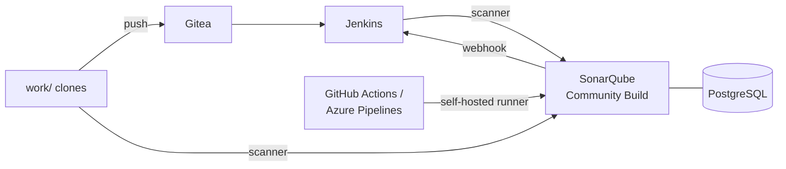

# SonarQube for DevOps – Hands-on Labs

Ten labs that take **BookShelf**, a small online bookstore with a Java and a Python service, from "nobody looks at code quality" to automated, gated code reviews in Jenkins, GitHub Actions and Azure DevOps.



## Labs

| # | Lab | You will… | Time |
|---|---|---|---|
| 01 | [Environment & tour](labs/LAB01-environment/README.md) | start SonarQube, Jenkins and Gitea, explore rules, profiles, gates | 35 min |
| 02 | [First analysis](labs/LAB02-first-analysis/README.md) | analyse Java with Maven and Python with SonarScanner CLI, read issues | 40 min |
| 03 | [Tests & coverage](labs/LAB03-tests-coverage/README.md) | import coverage and test reports, scope the analysis, understand new code | 40 min |
| 04 | [Third-party analyzers](labs/LAB04-third-party-analyzers/README.md) | import Bandit, Ruff, Pylint and your own tool (generic issue format) | 35 min |
| 05 | [Profiles & gates](labs/LAB05-profiles-gates/README.md) | build an inherited quality profile and a quality gate, block a release | 40 min |
| 06 | [Jenkins](labs/LAB06-jenkins/README.md) | analysis + `waitForQualityGate` in a pipeline, break the build on purpose | 45 min |
| 07 | [GitHub / Azure DevOps](labs/LAB07-github-azure-devops/README.md) | the same gate in GitHub Actions or Azure Pipelines with a self-hosted runner | 40 min |
| 08 | [Security](labs/LAB08-security/README.md) | permissions, templates, least-privilege tokens, triage security findings | 35 min |
| 09 | [Web API & custom rules](labs/LAB09-web-api-custom-rules/README.md) | reporting, custom rules from templates, quality configuration as code | 40 min |
| 10 | [Troubleshooting](labs/LAB10-troubleshooting/README.md) | six broken analyses to diagnose and fix | 35 min |

## Prerequisites

- Linux VM (Ubuntu 24.04 recommended): **4 vCPU, 8 GB RAM**, 30 GB disk
- Docker Engine with the Compose plugin, user in the `docker` group
- `git`, `curl`, `python3` – `sudo apt install -y git curl python3`
- `vm.max_map_count ≥ 524288` (LAB01 shows how)
- Free ports: 9000 (SonarQube), 8081 (Jenkins), 3000 (Gitea)
- LAB07 only: a GitHub account or an Azure DevOps organisation

## Quick start

```bash
git clone <this repository> sonarqube-labs && cd sonarqube-labs
chmod +x bin/*
./bin/lab up
./bin/lab gitea-init
```

| Service | URL | Login |
|---|---|---|
| SonarQube | <http://localhost:9000> | `admin` / `admin` → change on first login |
| Jenkins | <http://localhost:8081> | `admin` / `Jenkins-Lab-2026!` |
| Gitea | <http://localhost:3000> | `student` / `Gitea-Lab-2026!` |

## The `lab` helper

| Command | What it does |
|---|---|
| `./bin/lab up` / `down` / `ps` / `logs <svc>` | manage the environment |
| `./bin/lab gitea-init` | create Gitea repositories and the `work/` clones |
| `./bin/lab scan-java [-Dkey=value]` | build, test and analyse `work/bookshelf-java` (Maven in Docker) |
| `./bin/lab checks-py` | tests, coverage, Bandit, Ruff, Pylint for `work/bookshelf-py` |
| `./bin/lab scan-py [-Dkey=value]` | analyse `work/bookshelf-py` with SonarScanner CLI (Docker) |
| `./bin/lab breakfix <N>` | load a LAB10 scenario |
| `./bin/lab destroy` | delete containers **and** data |

The scan commands need `export SONAR_TOKEN=…` (LAB02).

## Repository layout

```
apps/bookshelf-java     Maven project, JUnit 5, JaCoCo, Jenkinsfile
apps/bookshelf-py       Python package, pytest, linters, Jenkinsfile, GitHub + Azure pipelines
env/                    docker-compose.yml, Jenkins image (plugins + Configuration as Code)
labs/                   lab instructions
break-fix/              LAB10 scenarios
bin/lab                 helper script
work/                   your Git working copies (created by gitea-init)
```

Verified with SonarQube Community Build 26.10, SonarScanner CLI 8.3 and sonar-maven-plugin 5.8.

## License

MIT – see [LICENSE](LICENSE).
