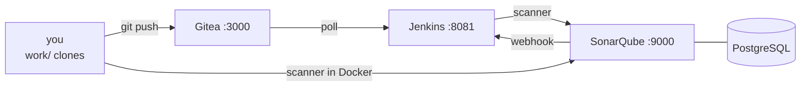

# LAB 01 – The lab environment & a tour of SonarQube

> **Story:** You are the new DevOps engineer at *BookShelf*, an online bookstore. After two production incidents (a SQL injection and a leaked password) management wants automated code reviews in every pipeline. Your toolbox: SonarQube, Jenkins and Gitea – all on one VM.

| | |
|---|---|
| **Duration** | ~35 min |
| **Result** | SonarQube, Jenkins and Gitea running; repositories cloned to `work/` |



## Step 1 – Host settings

SonarQube embeds Elasticsearch, which needs more memory maps and file handles than Linux allows by default:

```bash
sysctl vm.max_map_count fs.file-max
sudo sysctl -w vm.max_map_count=524288 fs.file-max=131072
echo -e 'vm.max_map_count=524288\nfs.file-max=131072' | sudo tee /etc/sysctl.d/99-sonarqube.conf
```

## Step 2 – Start everything

```bash
cd sonarqube-labs        # the folder you cloned the repository into
chmod +x bin/*
./bin/lab up          # first start builds the Jenkins image and takes a few minutes
./bin/lab ps
```

✅ **Checkpoint:** `./bin/lab up` ends with `waiting for SonarQube ... - UP` and four services are `running`.

```bash
curl -s http://localhost:9000/api/system/status
```

returns `{"id":"…","version":"26.10.…","status":"UP"}`.

## Step 3 – First login

1. Open <http://localhost:9000> and log in as `admin` / `admin`.
2. You are forced to change the password. The policy requires **at least 12 characters with upper case, lower case, a digit and a special character** – e.g. `Sonar-Training-2026!`. Write it down.

## Step 4 – Source repositories

```bash
./bin/lab gitea-init
ls work/
```

✅ **Checkpoint:** `work/bookshelf-java` and `work/bookshelf-py` exist, and <http://localhost:3000/student> shows both repositories (login `student` / `Gitea-Lab-2026!`).

From now on you work in `work/…` – these are real Git clones, so SonarQube gets blame information and can tell new code from old code.

## Step 5 – Guided tour

Explore the UI and answer the questions (write the answers down – we compare in 10 minutes):

| Where | Question |
|---|---|
| **Administration → System** | Which edition and version is running? Which database? |
| **Administration → Configuration → General Settings → Mode** | Is the instance in *Multi-Quality Rule (MQR)* mode or *Standard Experience*? What is the difference? |
| **Rules** | How many Python rules exist? Filter by *Software quality = Security*. |
| **Quality Profiles** | Which profile is the default for Java? How many rules does it activate compared with *Sonar way comprehensive*? |
| **Quality Gates** | Which conditions does *Sonar way* contain? Are they on new code or overall code? |
| **Administration → Security** | Which groups exist? Who may *Execute Analysis*? |

<details><summary>What to look for</summary>

- Community Build, version 26.10, PostgreSQL.
- MQR mode: every issue has *impacts* on Security / Reliability / Maintainability with severities Blocker → Info.
- Built-in profiles per language: **Sonar way core** (default, lean), **Sonar way extended**, **Sonar way comprehensive**, **Sonar agentic AI**.
- *Sonar way* gate: new issues > 0, coverage on new code < 80 %, duplications on new code > 3 %, security hotspots reviewed < 100 % – all on **new code**.
</details>

## Step 6 – Jenkins and Gitea

- Jenkins: <http://localhost:8081> – `admin` / `Jenkins-Lab-2026!`. Look at *Manage Jenkins → Plugins → Installed*: the **SonarQube Scanner** plugin is already there.
- Gitea: <http://localhost:3000> – your "GitHub" for the day.

## Troubleshooting

| Symptom | Likely cause |
|---|---|
| `sonarqube` restarts in a loop, log: `max virtual memory areas vm.max_map_count [65530] is too low` | Step 1 not done |
| `waiting for SonarQube.....` never ends | not enough RAM (SonarQube needs ~3 GB) – `./bin/lab logs sonarqube` |
| port 9000/8081/3000 already in use | another service on the VM – stop it or change the port in `env/docker-compose.yml` |
| `gitea-init`: `connection refused` | Gitea still starting – wait 10 s and repeat |
