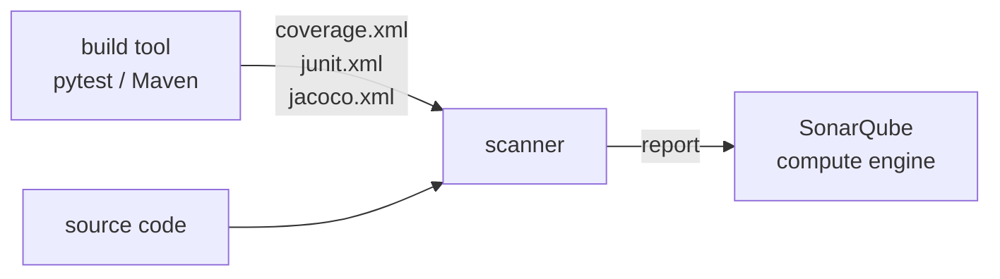

# LAB 03 – Tests, coverage & analysis parameters

> **Story:** The CTO asks a simple question: "How much of our code is tested?" SonarQube does not run tests – it **imports** the reports your build produces. Time to wire them in and tune what gets analysed.

| | |
|---|---|
| **Duration** | ~40 min |
| **You edit** | `work/bookshelf-py/sonar-project.properties`, `work/bookshelf-java/pom.xml` |



## Step 1 – Java: JaCoCo is already wired

Open `work/bookshelf-java/pom.xml`:

- `jacoco-maven-plugin` → `prepare-agent` + `report` writes `target/site/jacoco/jacoco.xml`
- `sonar.coverage.jacoco.xmlReportPaths` tells the scanner where to find it

Look at the project in SonarQube: **Coverage** ≈ 27 %. Open `InventoryReport.java` in the *Code* tab – red/green bars show uncovered/covered lines.

## Step 2 – Python: generate the reports

```bash
./bin/lab checks-py
ls work/bookshelf-py/reports/
```

✅ **Checkpoint:** `5 passed`, and `coverage.xml`, `junit.xml` exist (plus linter reports – LAB04).

## Step 3 – Python: import tests and coverage

In `work/bookshelf-py/sonar-project.properties` uncomment the **LAB03** block:

```properties
sonar.tests=tests
sonar.python.coverage.reportPaths=reports/coverage.xml
sonar.python.xunit.reportPath=reports/junit.xml
```

```bash
./bin/lab scan-py
```

✅ **Checkpoint:** the scanner log shows `Sensor Cobertura Sensor for Python coverage` → `Parsing report '/usr/src/reports/coverage.xml'`, and the dashboard shows Coverage ≈ 40 % and *Unit Tests: 5*.

> `sonar.sources` = production code, `sonar.tests` = test code. Test files are not counted in lines of code or coverage, and get their own (test) rules.

## Step 4 – Scoping the analysis

| Property | Effect |
|---|---|
| `sonar.exclusions` | files not analysed at all |
| `sonar.coverage.exclusions` | analysed, but ignored for coverage |
| `sonar.cpd.exclusions` | ignored for duplication detection |
| `sonar.test.inclusions` | which files under `sonar.tests` are tests |
| `sonar.issue.ignore.multicriteria` | ignore specific rules on specific files |

Task: the team agrees that generated protobuf files (`*_pb2.py`) must never be analysed, and that `orders.py` is "not worth testing". Add:

```properties
sonar.exclusions=**/*_pb2.py
sonar.coverage.exclusions=bookshelf/orders.py
```

Re-run `./bin/lab scan-py`. How did coverage change? Is that honest? Discuss – then **remove** the coverage exclusion again.

> Where to set parameters (highest priority first): command line `-D…` → scanner/build file (`sonar-project.properties`, `pom.xml`) → project settings in the UI → global settings. Prefer files in Git – they are reviewed and versioned.

## Step 5 – What is "new code"?

1. **Project Settings → New Code**: switch `bookshelf-py` to **Number of days = 30**. When is "previous version" better? When *reference branch*?
2. Make a change and commit it:

   ```bash
   cd work/bookshelf-py
   cat >> bookshelf/orders.py <<'EOF'


def gift_wrap_fee(items):
    fee = 0
    for item in items:
        if item.get("gift"):
            fee = fee + 2.5
    return fee
EOF
   git commit -qam "Add gift wrap fee" && cd ../..
   ./bin/lab checks-py && ./bin/lab scan-py
   ```

3. Open the **New Code** tab of the overview. What is the *coverage on new code*? Why does the quality gate still pass?

<details><summary>Answer</summary>

The new function is not tested → coverage on new code is low, but SonarQube ignores coverage and duplication conditions while the new code has **fewer than 20 lines** (to avoid failing on tiny changes). Add a few more untested lines (or lower the threshold in LAB05) and the gate turns red.
</details>

## Bonus

- Add a test for `gift_wrap_fee` in `tests/test_orders.py`, rerun – watch *coverage on new code* go to 100 %.
- Java: run `./bin/lab scan-java -Dsonar.coverage.exclusions=**/InventoryReport.java` – one-off parameters from the command line.

## Troubleshooting

| Symptom | Likely cause |
|---|---|
| `No report was found for sonar.python.coverage.reportPaths` | wrong path, or `checks-py` not run before the scan |
| coverage 0 % although the report is found | paths inside the report don't match the analysed files (run tests from the project root) |
| tests counted as code | `sonar.tests` missing, or `sonar.sources=.` without exclusions |
