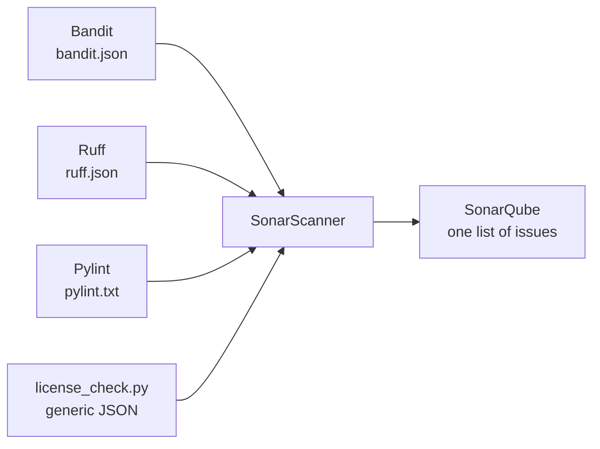

# LAB 04 – Third-party analyzers & the generic issue format

> **Story:** The Python team already runs Bandit, Ruff and Pylint – and Legal has an in-house script checking license headers. Nobody reads four different reports. You bring everything into SonarQube, next to its own findings.

| | |
|---|---|
| **Duration** | ~35 min |
| **You edit** | `work/bookshelf-py/sonar-project.properties` |



## Step 1 – Look at the raw reports

`./bin/lab checks-py` (LAB03) already produced them:

```bash
cd work/bookshelf-py
python3 -m json.tool reports/bandit.json | grep -E '"test_id"|"issue_text"' | head -20
head -5 reports/pylint.txt
python3 -m json.tool reports/license-issues.json | head -30
cd ../..
```

Find in Bandit's output the `eval`, `pickle` and `subprocess(shell=True)` findings that SonarQube's default profile did not report in LAB02.

## Step 2 – Import the linter reports

Uncomment the **LAB04** block in `sonar-project.properties`:

```properties
sonar.python.bandit.reportPaths=reports/bandit.json
sonar.python.ruff.reportPaths=reports/ruff.json
sonar.python.pylint.reportPaths=reports/pylint.txt
sonar.externalIssuesReportPaths=reports/license-issues.json
```

```bash
./bin/lab scan-py
```

✅ **Checkpoint:** the log shows `Sensor Import of Bandit issues`, `… Ruff issues`, `… Pylint issues` and `Imported 3 issues in 3 files` (license check). The project now has ~40 issues.

## Step 3 – External issues in the UI

1. **Issues** → facet **Rule**: rules starting with `external_bandit:`, `external_ruff:`, `external_pylint:` and `external_bookshelf-license-check:`.
2. Open an external issue. Compare with a native one: what is missing? (rule description, quality profile, "Why is this an issue?")
3. Which analyzer found what? Fill in:

| Problem in code | SonarQube (core) | Bandit | Ruff | Pylint |
|---|---|---|---|---|
| `eval(expression)` | | | | |
| `hashlib.md5` | | | | |
| mutable default `tags=[]` | | | | |
| bare `except:` | | | | |
| hard-coded `ADMIN_PASSWORD` | | | | |

> External issues are **not** controlled by quality profiles: to silence one, change the tool's configuration. They count in issue metrics and quality gates like any other issue.

## Step 4 – Your own analyzer: the generic issue format

Open `work/bookshelf-py/tools/license_check.py`. It writes the generic format:

```json
{
  "rules":  [{ "id": "license-header", "engineId": "bookshelf-license-check",
               "cleanCodeAttribute": "CONVENTIONAL",
               "impacts": [{ "softwareQuality": "MAINTAINABILITY", "severity": "LOW" }] }],
  "issues": [{ "ruleId": "license-header",
               "primaryLocation": { "message": "...", "filePath": "bookshelf/catalog.py",
                                    "textRange": { "startLine": 1 } } }]
}
```

Task: add the header `# Copyright BookShelf 2026` as the first line of `bookshelf/catalog.py`, rerun `./bin/lab checks-py && ./bin/lab scan-py` and check the issue disappeared.

**Challenge:** extend the checker with a second rule `no-print` (severity `MEDIUM`, quality `MAINTAINABILITY`) that reports every line containing `print(`.

## Step 5 – Discussion

- Which findings are duplicates between tools? Would you keep all four analyzers?
- What other tools could feed SonarQube? (Java: SpotBugs/PMD/Checkstyle reports; JS/TS: ESLint; Go: golangci-lint; any tool → generic format; SARIF via the generic format converters)

## Troubleshooting

| Symptom | Likely cause |
|---|---|
| `No issues information will be saved as the report file … can't be read` | wrong format for that property (e.g. a Pylint text file given to the Bandit property) |
| external issues missing, no error | file path in the report doesn't match an indexed file (must be relative to the project base dir) |
| generic import rejected | missing `rules` section, or `engineId` / `ruleId` mismatch |
