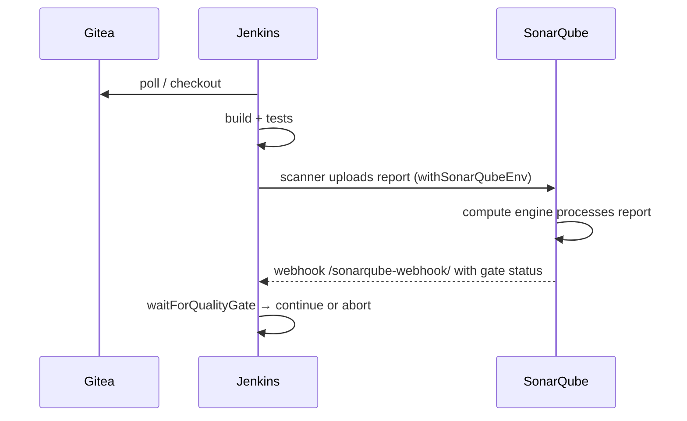

# LAB 06 – Jenkins: analysis and quality gate in the pipeline

> **Story:** Manual scans don't scale. Every push to Gitea must be built, tested, analysed – and the pipeline must **stop** when the quality gate fails.

| | |
|---|---|
| **Duration** | ~45 min |
| **You use** | Jenkins <http://localhost:8081> (`admin` / `Jenkins-Lab-2026!`), `work/*/Jenkinsfile` |



## Step 1 – A token for Jenkins

In SonarQube: **My Account → Security → Generate token** – name `jenkins`, type **Global Analysis Token**.

In Jenkins: **Manage Jenkins → Credentials → System → Global credentials → Add Credentials**

- Kind **Secret text**, Secret = the token, ID `sonarqube-token`.

## Step 2 – Tell Jenkins where SonarQube is

**Manage Jenkins → System → SonarQube servers**

- ☑ *Environment variables*
- Name **`sonarqube`** (the Jenkinsfiles use this name)
- Server URL **`http://sonarqube:9000`** (container name – both run in the `sonarlab` network)
- Server authentication token: `sonarqube-token` → **Save**.

## Step 3 – The scanner tool (for the Python pipeline)

**Manage Jenkins → Tools → SonarQube Scanner installations → Add**

- Name **`SonarScanner`**, ☑ *Install automatically* (from Maven Central, latest version) → **Save**.

Java does not need it – Maven brings its own `sonar-maven-plugin`.

## Step 4 – Webhook back to Jenkins

The pipeline must learn the quality gate result.

1. By default SonarQube refuses webhooks to private addresses – and `jenkins` resolves to one in the Docker network. **Administration → Configuration → General Settings → Security** → switch off **Enable local webhooks validation** → *Save*.

   > This protects against SSRF: anyone allowed to create webhooks could make SonarQube call internal services. Switch it off only when SonarQube and the CI server live in the same private network – as here – and keep the *Administer* permission tight.

2. **Administration → Configuration → Webhooks → Create**:
   - Name `jenkins`, URL **`http://jenkins:8080/sonarqube-webhook/`** (the trailing `/` is required) → *Create*.

## Step 5 – Pipeline jobs

Read `work/bookshelf-java/Jenkinsfile` – three stages: build & test, analysis inside `withSonarQubeEnv('sonarqube')`, `waitForQualityGate abortPipeline: true` inside a `timeout`.

In Jenkins: **New Item** → `bookshelf-java` → **Pipeline** →

- *Pipeline script from SCM* → Git → Repository URL `http://gitea:3000/student/bookshelf-java.git`
- Branch `*/main`, Script path `Jenkinsfile` → **Save** → **Build Now**.

Create `bookshelf-py` the same way (repository `bookshelf-py`).

✅ **Checkpoint:** both builds reach the *Quality gate* stage. The console log shows `SonarQube task '…' status is 'IN_PROGRESS'`, then `… completed. Quality gate is 'OK'` – or `'ERROR'` and the build fails (`bookshelf-py` with your `BookShelf gate` from LAB05!). The job page shows a SonarQube badge with a link to the project.

## Step 6 – Break the build on purpose

1. `bookshelf-java` uses the *Sonar way* gate, which requires **0 new issues**. Add a new bug:

   ```bash
   cd work/bookshelf-java
   cat > src/main/java/com/bookshelf/Discounts.java <<'EOF'
package com.bookshelf;

public class Discounts {
    public boolean isPromo(String code) {
        return code == "SPRING26";
    }
}
EOF
   git add -A && git commit -qm "Add promo codes" && git push -q && cd ../..
   ```

2. Wait for the poll (≤ 2 min) or click **Build Now**.

✅ **Checkpoint:** the build is red: `Pipeline aborted due to quality gate failure: ERROR`. In SonarQube the new issue is in the *New Code* tab.

3. Fix it (`"SPRING26".equals(code)`), commit, push – the build is green again.

## Step 7 – Discussion

- What happens if the webhook is missing? (→ the `timeout` aborts after 5 min – try it in LAB10)
- Why a *Global* analysis token here, and when a *Project* analysis token?
- `abortPipeline: true` vs. `false` + checking `qg.status` in a scripted step – when would you not fail the build?
- Branches & pull requests: analysis of multiple branches and PR decoration require a commercial edition (Developer+) or SonarQube Cloud. With Community Build, analyse `main` and gate the merge there.

## Troubleshooting

| Symptom | Likely cause |
|---|---|
| `No SonarQube installation found for 'sonarqube'` | name in *System* ≠ name in the Jenkinsfile |
| `Tool type "hudson.plugins.sonar.SonarRunnerInstallation" does not have an install of "SonarScanner"` | Step 3 missing / different name |
| webhook: `Invalid URL: loopback, wildcard, link-local, site-local … are not allowed` | *Enable local webhooks validation* still on – Step 4.1 |
| quality gate stage waits until the timeout | webhook missing, wrong URL, or Jenkins URL not reachable from SonarQube |
| `ERROR: Not authorized` | wrong credential ID / token revoked |
| checkout fails | use `http://gitea:3000/...` (container network), not `localhost` |
