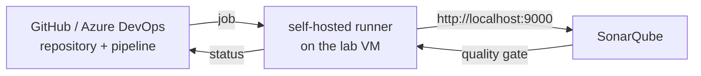

# LAB 07 – GitHub Actions or Azure DevOps

> **Story:** Half of BookShelf's teams live on GitHub, the other half on Azure DevOps. You prove that the same SonarQube can gate both. Pick **one track** (or both if you are fast).

| | |
|---|---|
| **Duration** | ~40 min |
| **Requires** | a GitHub account **or** an Azure DevOps organisation where you can create a project |
| **You use** | `work/bookshelf-py/.github/workflows/sonarqube.yml` or `work/bookshelf-py/azure-pipelines.yml` |

Our SonarQube runs on a private VM, so cloud-hosted runners cannot reach it. We install a **self-hosted runner / agent on the lab VM** – a common pattern for private SonarQube instances. (With a public SonarQube URL you would use hosted runners instead.)



---

## Track A – GitHub Actions

### A1 – Repository

1. Create a **private** repository `bookshelf-py` on GitHub (no README).
2. Push the working copy as a second remote:

   ```bash
   cd work/bookshelf-py
   git remote add github https://github.com/<you>/bookshelf-py.git
   git push github main      # use a GitHub personal access token as password
   cd ../..
   ```

### A2 – Self-hosted runner

GitHub → repository → **Settings → Actions → Runners → New self-hosted runner → Linux x64**. Run the shown commands on the lab VM in a new folder (e.g. `~/actions-runner`): download, `./config.sh --url … --token …`, then `./run.sh` (keep the terminal open).

The runner user must be able to run Docker (`groups` contains `docker`).

### A3 – Secrets

Repository → **Settings → Secrets and variables → Actions → New repository secret**:

| Name | Value |
|---|---|
| `SONAR_HOST_URL` | `http://localhost:9000` |
| `SONAR_TOKEN` | a new **Project Analysis Token** for `bookshelf-py` (SonarQube → My Account → Security) |

### A4 – Run the workflow

Read `.github/workflows/sonarqube.yml`:

- `fetch-depth: 0` – full history for blame and new code
- tests + linters in a Python container
- `SonarSource/sonarqube-scan-action@v8` with `-Dsonar.qualitygate.wait=true` – the step fails when the gate fails

**Actions → SonarQube analysis → Run workflow** (or push a commit).

✅ **Checkpoint:** the job runs on your runner (`Runner name: …` in the log); with `BookShelf gate` from LAB05 it fails at the scan step with `QUALITY GATE STATUS: FAILED`. Fix the coverage problem or switch the project back to *Sonar way* and re-run → green.

### A5 – Protect `main`

**Settings → Branches → Add branch ruleset**: require the status check `sonarqube` before merging. Now a failed gate blocks the merge button.

> PR decoration (SonarQube comments directly on the pull request) and branch analysis need SonarQube Server Developer Edition or higher, or SonarQube Cloud. With Community Build the gate result is visible as the job status.

---

## Track B – Azure DevOps

### B1 – Project and repository

1. Create a project `BookShelf` in your organisation, **Repos → Import** or push the working copy:

   ```bash
   cd work/bookshelf-py
   git remote add azure https://dev.azure.com/<org>/BookShelf/_git/bookshelf-py
   git push azure main       # use a personal access token as password
   cd ../..
   ```

### B2 – Self-hosted agent

**Project settings → Agent pools → Default → New agent → Linux**. On the lab VM: download, `./config.sh` (server URL `https://dev.azure.com/<org>`, PAT with *Agent Pools: Read & manage*), then `./run.sh`.

### B3 – SonarQube extension and service connection

1. The **SonarQube** extension is pre-installed in Azure DevOps Services (otherwise: Marketplace → *SonarQube* by SonarSource).
2. **Project settings → Service connections → New → SonarQube Server**
   - Server URL `http://localhost:9000`, Token = a project analysis token for `bookshelf-py`, name **`sonarqube-lab`**.

### B4 – Pipeline

**Pipelines → New pipeline → Azure Repos Git → bookshelf-py → Existing YAML file → `/azure-pipelines.yml`** → Run.

Read the YAML: `SonarQubePrepare@8` (`scannerMode: cli`, `configMode: file` = read `sonar-project.properties`), `SonarQubeAnalyze@8`, `SonarQubePublish@8`.

✅ **Checkpoint:** the run summary has an **Extensions** tab with the SonarQube quality gate status.

`SonarQubePublish` *shows* the gate but doesn't fail the run. To fail it, add to the Prepare task:

```yaml
      extraProperties: |
        sonar.qualitygate.wait=true
```

### B5 – Import from Azure DevOps (optional)

SonarQube **Administration → DevOps Platform Integrations → Azure DevOps** (needs a PAT with *Code: Read*), then **Create project → From Azure DevOps** – projects are created with the right key and repository link.

---

## Discussion

- Jenkins vs. GitHub Actions vs. Azure Pipelines: where does the token live, who can read it?
- Self-hosted runners on a shared VM – what are the security implications?
- How would you roll this out to 200 repositories? (templates, reusable workflows, org-level secrets)

## Troubleshooting

| Symptom | Likely cause |
|---|---|
| job stays *Queued* | the runner/agent is not running or has other labels/pool |
| `Not authorized` | wrong secret / service connection token |
| `Connection refused localhost:9000` | runner is not on the lab VM, or SonarQube is down |
| `docker: permission denied` | runner user not in the `docker` group – `sudo usermod -aG docker $USER`, log in again |
